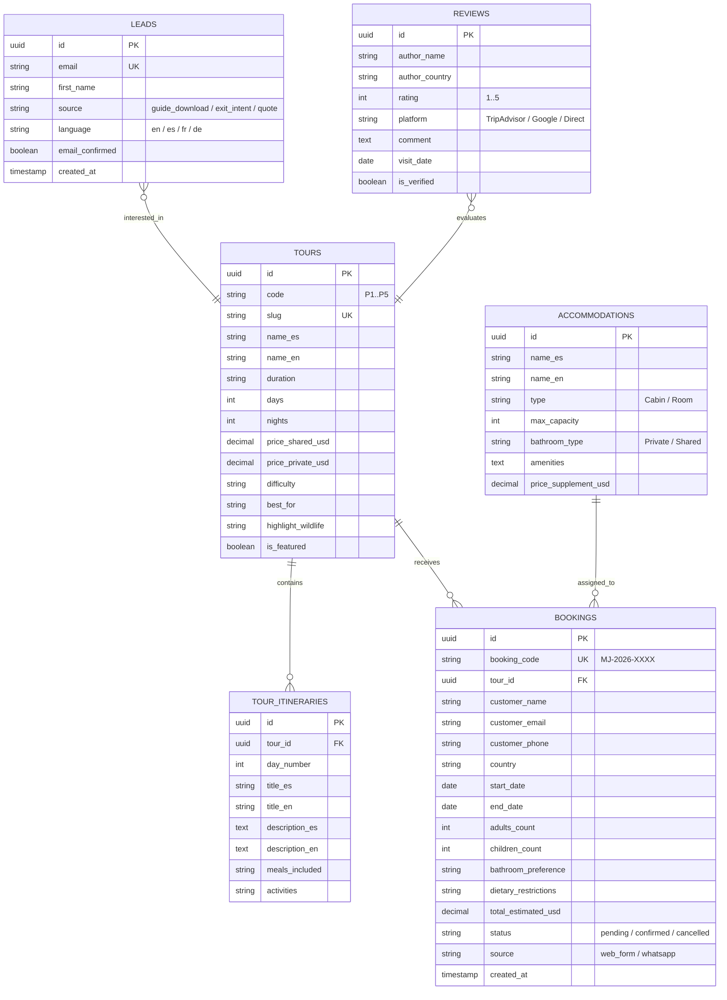

# ARQUITECTURA TÉCNICA, UX/UI, SEO Y ESPECIFICACIONES DE DISEÑO
## MADIDI JUNGLE ECOLODGE

---

## 1. MAPA DEL SITIO NUEVO (ARQUITECTURA DE INFORMACIÓN)

```mermaid
graph TD
    Home["/ (Home - Hero, Experiencia Inmersiva, Cotizador Rápido, WhatsApp)"]
    
    Home --> Experiencias["/experiencias (Categorías: Trekking, Aves, Selva Profunda, Cultura)"]
    Home --> Programas["/programas (Catálogo y Comparador de Precios)"]
    Home --> Alojamiento["/alojamiento (Cabañas Jatata, Comodidades, Vida en la Selva)"]
    Home --> Madidi["/parque-madidi (Biodiversidad, Mapa Interactivo, Cómo Llegar)"]
    Home --> Comunidad["/comunidad (Pueblo Uchupiamonas, Conservación, Impacto Social)"]
    Home --> Galeria["/galeria (Fotos y Videos Filtrables: Fauna, Flora, Vida en el Lodge)"]
    Home --> Testimonios["/testimonios (TripAdvisor, Reseñas Verificadas, Libro de Visitas)"]
    Home --> Blog["/blog (Artículos SEO: Guías de Aves, Logística La Paz-Rurrenabaque, Fotografía)"]
    Home --> Contacto["/contacto (Formulario Inteligente, WhatsApp Directo, Oficina Rurre)"]
    Home --> FAQ["/preguntas-frecuentes (Vacunas, Clima, Equipaje, Dinero, Políticas)"]
    Home --> Reservar["/reservar (Motor de Cotización y Solicitud en 3 Pasos)"]

    Programas --> P1["/programas/cullpana-1d (Full Day Selva)"]
    Programas --> P2["/programas/mapajo-2d-1n (Aventura Esencial)"]
    Programas --> P3["/programas/tareche-3d-2n (Clásico Madidi - Más Popular)"]
    Programas --> P4["/programas/wabu-4d-3n (Inmersión en Selva Primaria)"]
    Programas --> P5["/programas/biwa-5d-4n (Expedición Biológica Profunda)"]
```



---

## 2. WIREFRAMES EN TEXTO Y FLUJOS DE USUARIO

### 2.1 Flujo de Usuario Principal: "Descubrimiento a Reserva / WhatsApp"
1. **Entrada:** El usuario aterriza en `/` buscando "Bolivia amazon tours" desde Google o redes sociales.
2. **Hero Inmersivo:** Ve video de navegación por el cañón del río Tuichi + titular emocional ("El corazón virgen del Parque Nacional Madidi").
3. **Barra de Cotización Rápida:** En la cabecera misma puede seleccionar fechas tentativas, cantidad de viajeros y tipo de viaje (Aventura, Aves, Relax).
4. **Comparador Visual de Programas:** Observa la tarjeta del programa Tareche (3D/2N, más popular, $290 USD), ve la fauna garantizada, los días y el tipo de cabaña.
5. **Acción Dual de Conversión:**
   - **Opción A (Reserva en Línea):** Hace clic en "Cotizar & Reservar", se abre el wizard interactivo en 3 pasos con cálculo automático de moneda (USD/EUR/BOB) y confirmación inmediata.
   - **Opción B (WhatsApp Express):** Hace clic en el botón "Consultar por WhatsApp", abriendo la app con el mensaje estructurado prellenado con los datos de su selección.

### 2.2 Wireframe en Texto: Home Page
```text
+--------------------------------------------------------------------------+
| [LOGO MADIDI JUNGLE]   Programas  Alojamiento  Madidi  Comunidad   [EN|ES|FR|DE] [$ USD] [RESERVAR AHORA] |
+--------------------------------------------------------------------------+
| HERO SECTION                                                             |
| Video de fondo: Lancha sobre río Tuichi / Guacamayo sobrevolando el dosel |
| H1: La Experiencia Más Auténtica en el Parque Nacional Madidi             |
| Subtítulo: 100% Indígena. Selva Primaria Virgen. Guías Nativos Locales.  |
|                                                                          |
| [ BARRA FLOTANTE DE BÚSQUEDA Y COTIZACIÓN:                              ] |
| [ Programa: (Cualquiera v) | Viajeros: (2 Adultos v) | Fechas | [BUSCAR] ] |
+--------------------------------------------------------------------------+
| SOCIAL PROOF & BADGES:                                                   |
| [TripAdvisor Travelers' Choice 5/5] [SERNAP Autorizado] [100% Nativo]    |
+--------------------------------------------------------------------------+
| DESTACADOS: NUESTROS PROGRAMAS EMBLEMÁTICOS                             |
| [Card 1: Mapajo 2D/1N]  [Card 2: Tareche 3D/2N (⭐ Popular)]  [Card 3: Wabu 4D/3N] |
| Foto / Días / Fauna / Precio desde $205 USD / [Ver Itinerario] [Cotizar] |
+--------------------------------------------------------------------------+
| COMPARADOR DINÁMICO DE PROGRAMAS Y PRECIOS                               |
| Tabla interactiva con selector de Baño Privado / Compartido y Moneda     |
+--------------------------------------------------------------------------+
| MAPA INTERACTIVO: EL VIAJE HACIA LO SALVAJE                              |
| Rurrenabaque -> Río Beni -> Cañón del Bala -> Río Tuichi -> Ecolodge     |
+--------------------------------------------------------------------------+
| ALOJAMIENTO EN ARMONÍA CON LA NATURALEZA                                 |
| Cabañas de jatata, mosquiteros integrales, agua pura de manantial        |
+--------------------------------------------------------------------------+
| NUESTRO PUEBLO: SAN JOSÉ DE UCHUPIAMONAS                                 |
| Cómo tu visita protege 1.8 millones de hectáreas de selva amazónica      |
+--------------------------------------------------------------------------+
| PREGUNTAS FRECUENTES (FAQ ACORDEÓN)                                      |
| ¿Cómo llegar desde La Paz? | ¿Vacunas requeridas? | ¿Época recomendada?  |
+--------------------------------------------------------------------------+
| FOOTER: Enlaces, Certificados, Suscripción Guía de Aves, Redes, Contacto |
+--------------------------------------------------------------------------+
| [BOTÓN FLOTANTE WHATSAPP: "Habla con nuestro guía nativo"]               |
+--------------------------------------------------------------------------+
```

---

## 3. ARQUITECTURA TÉCNICA

- **Frontend:**
  - **Framework:** Next.js 14/15 con App Router y Server-Side Rendering (SSR) / Static Site Generation (SSG).
  - **Lenguaje:** TypeScript con tipado estricto.
  - **Estilos:** Tailwind CSS con tokens de diseño personalizados y sistema de diseño atómico.
  - **Animaciones:** Framer Motion para transiciones suaves a 60fps optimizadas para Core Web Vitals.
  - **Iconografía:** Lucide React para iconografía moderna y liviana.
  - **Internacionalización (i18n):** Soporte para Español, Inglés, Francés y Alemán.

- **Backend:**
  - **Framework:** FastAPI (Python 3.11+ / 3.14+) con arquitectura modular por routers.
  - **Validación de Datos:** Pydantic v2 para validación estricta de esquemas de entrada/salida.
  - **Base de Datos:** PostgreSQL con SQLAlchemy async / motor relacional con índices B-Tree y GIN para búsqueda full-text.
  - **Seguridad:** CORS configurado para orígenes de producción, sanitización de inputs y rate-limiting en formularios de contacto/leads.

- **Integraciones:**
  - **WhatsApp Business API / Deep Links:** Generación de enlaces con metadatos estructurados para conversión instantánea.
  - **Lead Magnet Engine:** Generación y entrega automatizada de la "Guía de Campo y Aves del Madidi".
  - **TripAdvisor / Google Reviews API:** Consumo cacheado de opiniones verificadas para mantener el LCP < 1.5s.

---

## 4. MODELO DE DATOS (POSTGRESQL)



---

## 5. DESIGN SYSTEM Y PALETA CROMÁTICA

Inspirada en el dosel de la selva virgen del Madidi, las arenas del río Tuichi, las maderas nobles de las cabañas y los colores de la flor de Heliconia:

- **Jungle Dark (Fondo y Textos Principales):** `#0B1F14` (Verde selvático ultra profundo, contraste superior a 14:1 sobre blanco)
- **Deep Moss (Acentos Primarios):** `#1E4D2B` (Verde musgo orgánico)
- **Canopy Gold (Detalles y Estrellas):** `#DDA15E` (Dorado madera y sol filtrado)
- **Clay Terra (Llamados a la Acción / CTA):** `#C85A32` (Tierra arcillosa amazónica, alto impacto visual y excelente contraste)
- **River Mist (Superficies secundarias):** `#F4F6F0` (Gris arena claro, reduce fatiga visual frente a blancos puros)
- **Pure Sand:** `#EAE4D7` (Detalles de fondos de tarjetas y divisores)

### Tipografía:
- **Titulares:** `Outfit` / `Playfair Display` (elegante, aventurera, editorial, evoca revistas de exploración).
- **Cuerpo y UI:** `Inter` / `Plus Jakarta Sans` (ultra-legible en pantallas móviles a partir de 16px, optimizado para WCAG 2.2).

---

## 6. ESPECIFICACIONES DE ACCESIBILIDAD WCAG 2.2 AA

1. **Ratios de Contraste:** Mínimo de 4.5:1 para texto normal y 3.0:1 para elementos de interfaz y texto grande (24px+). El color de botón `#C85A32` con texto blanco `#FFFFFF` alcanza un ratio de 4.85:1 (Cumple WCAG AA).
2. **Navegación Completa por Teclado:**
   - Indicador `:focus-visible` mediante anillo de foco de 2px `ring-offset-2 ring-emerald-600`.
   - Menús desplegables controlables con `Tab`, `Shift+Tab`, `Enter` y `Escape`.
   - Skip links visibles al tabular: "Saltar al contenido principal" (`#main-content`).
3. **Roles ARIA y Etiquetas Semánticas:**
   - Atributos `aria-expanded`, `aria-controls` en acordeones y menús.
   - Atributos `aria-live="polite"` en el cotizador interactivo para anunciar el cambio de precio dinámico a lectores de pantalla.
4. **Respeto a Preferencias del Sistema:**
   - Media query `@media (prefers-reduced-motion: reduce)` para deshabilitar transiciones complejas a usuarios propensos al mareo visual.

---

## 7. PLAN SEO INTERNACIONAL Y SCHEMA.ORG

### 7.1 Arquitectura Multilingüe (hreflang)
- `https://madidijungle.com/en/tours/tareche-3d-2n` (`hreflang="en"`)
- `https://madidijungle.com/es/programas/tareche-3d-2n` (`hreflang="es"`)
- `https://madidijungle.com/fr/circuits/tareche-3d-2n` (`hreflang="fr"`)
- `https://madidijungle.com/de/touren/tareche-3d-2n` (`hreflang="de"`)
- `https://madidijungle.com/tours/tareche-3d-2n` (`hreflang="x-default"`)

### 7.2 Esquemas JSON-LD Implementados
- `LodgingBusiness`: Con coordenadas GPS exactas en el Parque Madidi, amenidades eco-sostenibles, teléfono oficial y horarios.
- `TouristTrip`: Para cada programa (Cullpana, Mapajo, Tareche, Wabu, Biwa) con duración en formato ISO 8601 (`P3D`), precio en USD, proveedor y tipo de itinerario.
- `FAQPage`: Para la página de preguntas frecuentes con respuestas completas sobre logística La Paz - Rurrenabaque y vacunas.
- `AggregateRating`: Calificación promedio de 4.9/5 basada en 450+ reseñas verificadas.

---
*Este documento rige la implementación del código a continuación.*
