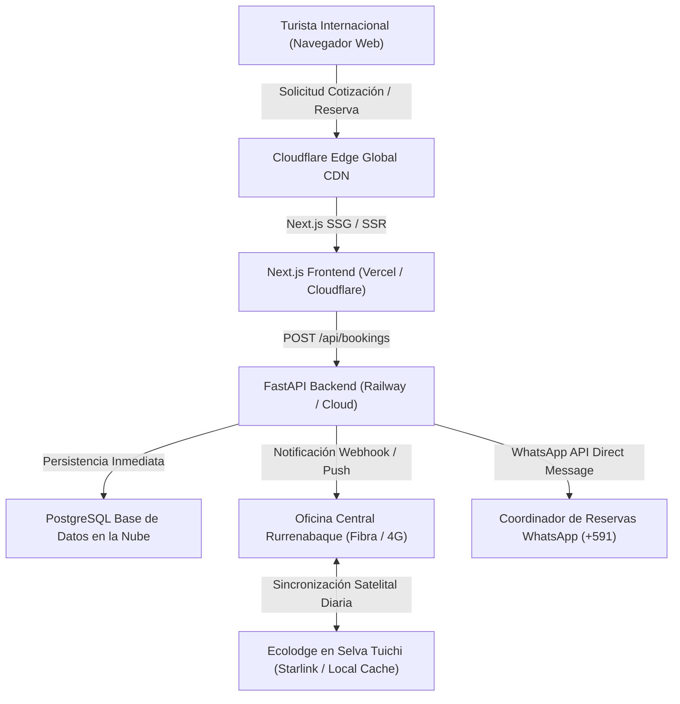

# ESTRATEGIA DE MANTENIMIENTO, OBSERVABILIDAD Y OPERACIONES
## MADIDI JUNGLE ECOLODGE

---

## 1. OBJETIVOS DE RENDIMIENTO Y CORE WEB VITALS (SLO)

Para garantizar la máxima retención de turistas internacionales navegando desde redes móviles 4G/5G en aeropuertos o conexiones lentas en Sudamérica, la plataforma web implementa los siguientes Objetivos de Nivel de Servicio (SLO):

| Métrica | Objetivo Madidi Jungle | Umbral "Pobre" de Google | Estrategia de Optimización |
| :--- | :--- | :--- | :--- |
| **Largest Contentful Paint (LCP)** | **< 1.8 segundos** | > 4.0 segundos | • Carga anticipada (`fetchpriority="high"`) de la imagen Hero. • Compresión WebP/AVIF servida desde Cloudflare CDN edge. • Server-Side Rendering (SSR) y pre-renderizado estático de rutas clave. |
| **Interaction to Next Paint (INP)** | **< 120 milisegundos** | > 500 milisegundos | • Componentes React desacoplados sin bloqueos en el hilo principal. • Cálculos dinámicos de cotización diferidos mediante micro-tareas. |
| **Cumulative Layout Shift (CLS)** | **< 0.05** | > 0.25 | • Atributos `width` y `height` explícitos en todos los contenedores multimedia. • Espacios reservados (skeletons) fijos para tarjetas de programas y modales. |
| **First Contentful Paint (FCP)** | **< 0.9 segundos** | > 3.0 segundos | • Inlining de CSS crítico de Tailwind. • Preconexión DNS a CDNs de imágenes (`images.unsplash.com`). |

---

## 2. ARQUITECTURA DE RESILIENCIA EN SELVA Y CONECTIVIDAD SATELITAL

Madidi Jungle Ecolodge opera en un entorno geográfico aislado en el Parque Nacional Madidi, comunicado vía internet satelital (Starlink) y radio HF. La arquitectura del sistema está diseñada para tolerar interrupciones de conectividad:

### Protocolo de Continuidad Operativa:
1. **Fallback Standalone:** El frontend Next.js incluye un store local sincronizado (`mockData.ts`), permitiendo que el usuario navegue el catálogo de tours, explore itinerarios y calcule precios incluso ante caídas momentáneas del backend.
2. **Doble Canal de Conversión:** Si el envío por API falla por cortes temporales, el botón "Continuar por WhatsApp Express" genera un enlace directo al teléfono móvil del operador en Rurrenabaque con todos los datos encriptados en la URL, asegurando que ninguna reserva se pierda.
3. **Resguardo de Leads:** Todos los correos de captura (descargas de la Guía de Campo) se almacenan en cola local antes de despachar el correo de confirmación.

---

## 3. POLÍTICA DE COPIAS DE SEGURIDAD (BACKUPS)

- **Frecuencia:** Copias completas automáticas diarias de la base de datos PostgreSQL a las 02:00 AM (hora de Bolivia, UTC-4).
- **Destino:** Almacenamiento seguro en Cloudflare R2 / AWS S3 con cifrado AES-256 en reposo.
- **Retención:**
  - Backups diarios: Retención de 30 días.
  - Backups semanales: Retención de 12 semanas.
  - Backups mensuales: Retención de 24 meses (para fines contables y de auditoría de turismo).
- **Prueba de Recuperación (Disaster Recovery):** Simulación de restauración trimestral para garantizar un RTO (Recovery Time Objective) menor a 30 minutos y un RPO (Recovery Point Objective) menor a 24 horas.

---

## 4. OBSERVABILIDAD Y MONITOREO EN TIEMPO REAL

1. **Monitoreo de Errores (Sentry):**
   - Rastreo de excepciones en tiempo real en frontend (React hydration, errores de render) y backend (FastAPI HTTPException, fallos de conexión a base de datos).
   - Alertas automáticas enviadas al equipo de desarrollo ante tasas de error superiores al 1%.
2. **Analítica Privada y Conversión (PostHog / Plausible):**
   - Seguimiento del embudo de conversión sin cookies invasivas (cumplimiento estricto de GDPR para turistas europeos).
   - Eventos medidos:
     - `click_tour_itinerary`
     - `calculate_quote`
     - `click_whatsapp_direct`
     - `submit_booking_form`
     - `download_field_guide`
3. **Monitoreo de Uptime:**
   - Comprobaciones cada 60 segundos del endpoint `/health` de la API desde múltiples nodos geográficos (EE.UU., Europa, Brasil) mediante UptimeRobot o BetterUptime.

---

## 5. SEGURIDAD Y CUMPLIMIENTO LEGAL

1. **Protección contra Inyecciones y Ataques:**
   - Validación y sanitización rigurosa de todos los campos mediante esquemas Pydantic v2.
   - Uso de consultas preparadas y parámetros tipados en SQLAlchemy/PostgreSQL.
   - Cabeceras de seguridad estrictas: `X-Frame-Options: DENY`, `X-Content-Type-Options: nosniff`, `Content-Security-Policy`.
2. **Protección contra Spam:**
   - Rate limiting en endpoints de creación de reservas (`/api/bookings`) y formularios de contacto (`/api/contact`) limitando a un máximo de 5 solicitudes por minuto por dirección IP.
   - Campos señuelo (Honeypot invisible) en formularios para bloquear bots automatizados sin molestar al usuario humano con captchas tediosos.
3. **Cumplimiento y Privacidad:**
   - Respeto al derecho de baja en el boletín informativo (Lead Magnet).
   - Aviso de consentimiento y política de privacidad transparente para reservas internacionales.

---

## 6. CALENDARIO DE MANTENIMIENTO PREVENTIVO

- **Semanal:** Revisión de logs de errores, verificación de entrega de correos de leads y comprobación de enlaces WhatsApp.
- **Mensual:** Actualización de dependencias de seguridad de Node.js y Python; optimización y análisis de consultas lentas en PostgreSQL.
- **Trimestral:**
  - Auditoría de SEO internacional y revisión de rankings de palabras clave ("Madidi National Park tours", "Bolivia jungle tours").
  - Verificación de precios de temporada (temporada seca de mayo a octubre vs temporada verde de lluvias).
  - Recolección y actualización de nuevas reseñas verificadas de TripAdvisor y fotos de viajeros.
- **Anual:** Renovación de certificados SSL/TLS y auditoría de accesibilidad WCAG 2.2 con lectores de pantalla.
